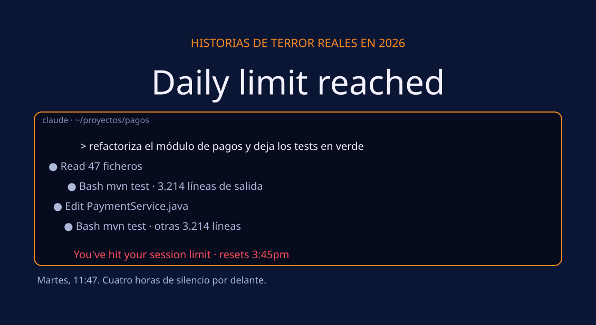
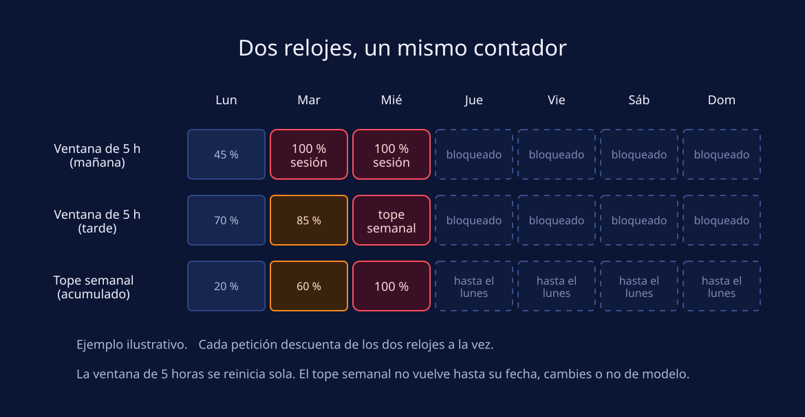
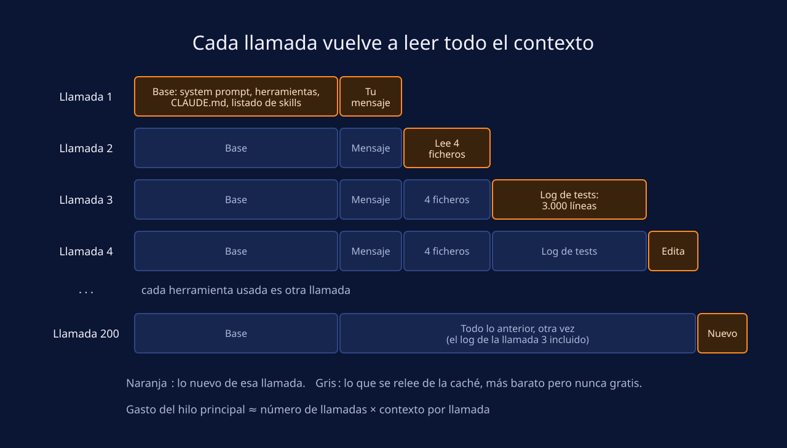
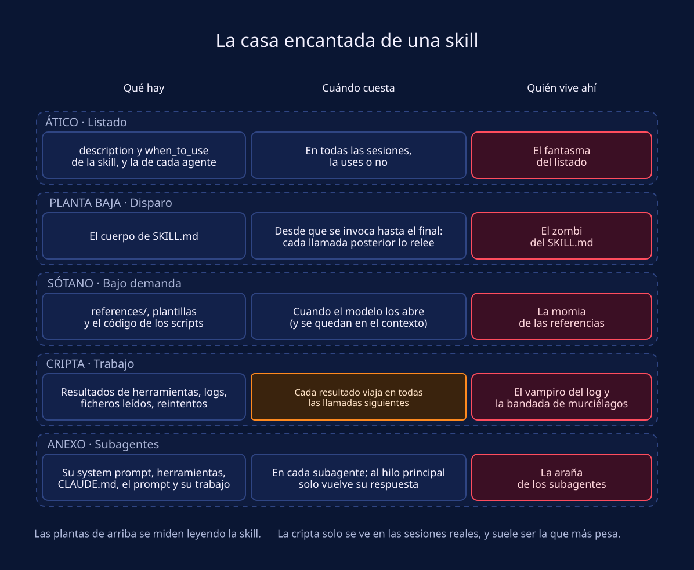
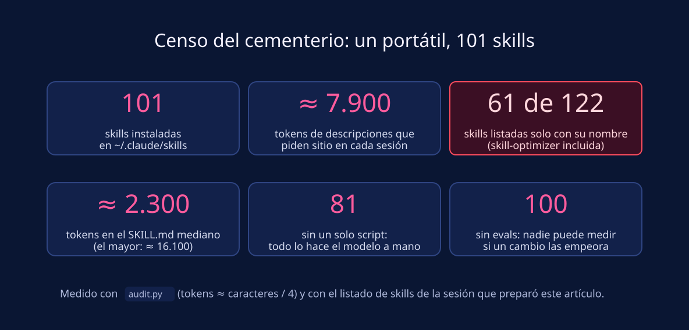
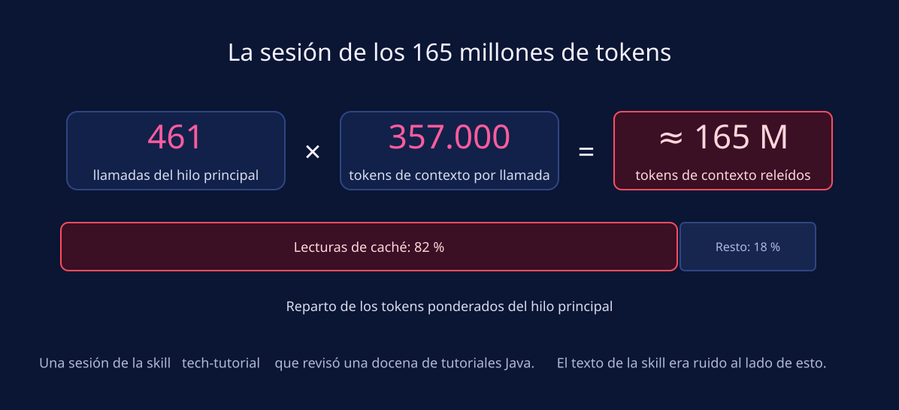
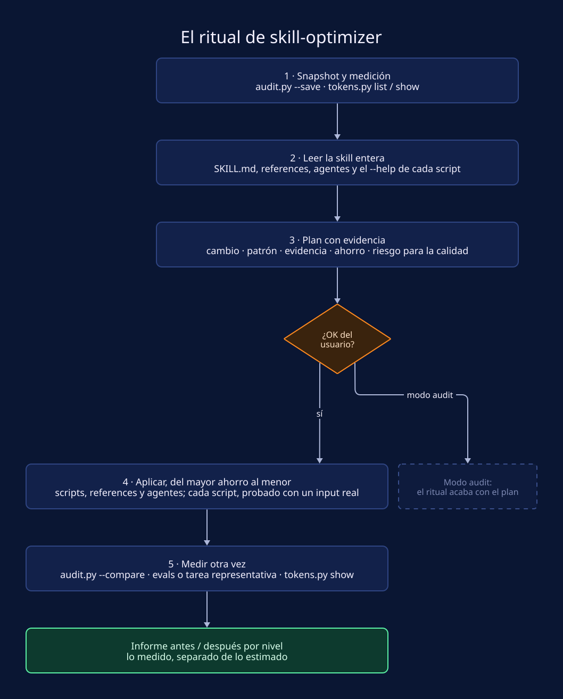
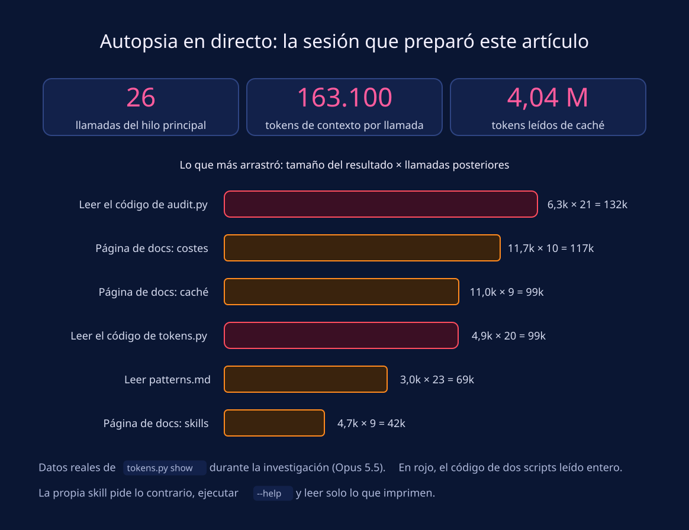
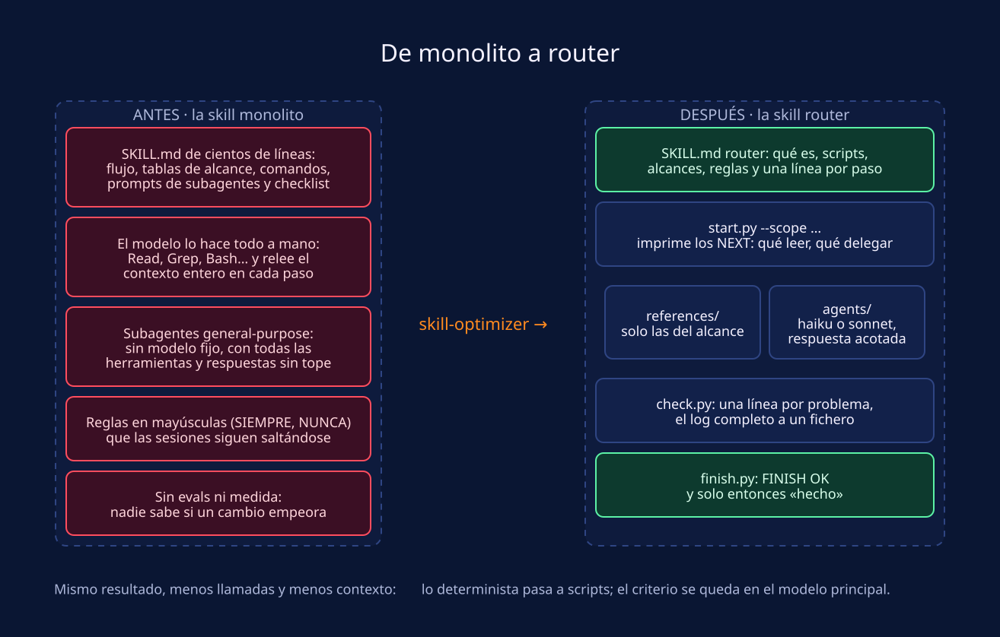
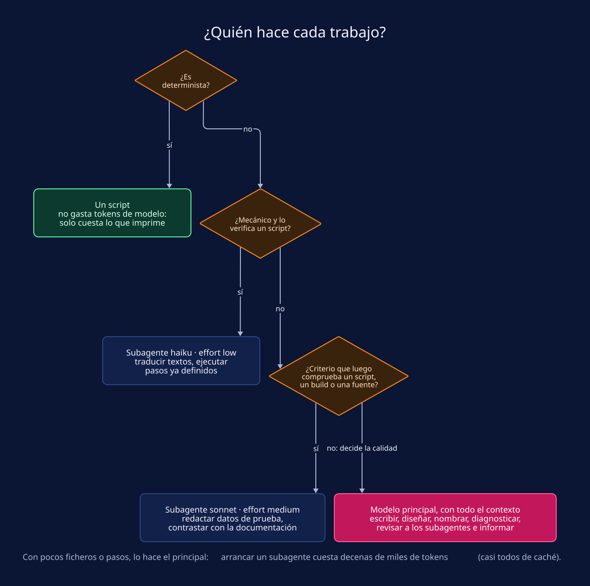

# Historias de terror reales en 2026: Daily limit reached

*Tus tokens no desaparecen solos: algo se los come. Autopsia técnica del límite de uso de Claude Code, y el exorcismo que lo cura sin perder calidad.*



> **Idea de partida:** el contador de uso mide lo que Claude vuelve a leer en cada llamada, y eso pesa mucho más que lo que tú escribes. Encuentra lo que se queda dentro del contexto, sácalo con scripts y medidas, y el límite deja de dar miedo.

**Lectura:** unos 20 minutos · **Para quién:** quien usa Claude Code a diario y quien escribe skills para su equipo.

Martes, 11:47. Llevas dos horas con Claude Code refactorizando el módulo de pagos. Los tests por fin pasan en local. Escribes «ahora actualiza la documentación» y la terminal, en vez de contestar, te enseña esto:

```text
You've hit your session limit · resets 3:45pm
```

Cuatro horas de silencio. Y solo es martes: el tope semanal ya va por el 60 %.

Si usas Claude Code a diario, la escena te sonará. Lo inquietante del mensaje es no saber qué se ha comido los tokens, porque casi nunca es lo que parece. En este artículo hacemos la autopsia: dónde se van de verdad, qué monstruos viven dentro de tus skills y cómo los sacamos con **skill-optimizer**, una skill que hemos creado en Virtual Cave para que las demás gasten lo mínimo sin perder calidad.

**Qué vas a aprender:**

1. Qué miden los límites de sesión y semanal de Claude Code, y dónde vigilarlos.
2. Por qué el gasto crece con el número de llamadas y con el contexto de cada una, y qué acciones tiran la caché.
3. En qué momento gasta cada parte de una skill (listado, `SKILL.md`, references, trabajo y subagentes) y qué seis costumbres disparan el consumo.
4. Cómo medir una skill y sus sesiones reales con skill-optimizer, y cómo aplicar sus cambios sin perder calidad.
5. Qué puedes hacer esta misma noche, tanto si usas Claude Code como si escribes skills.

El recorrido va de los relojes y la caché a la anatomía de una skill, pasa por un censo y un caso real, y acaba con el ritual de skill-optimizer y un kit de supervivencia.

## 1. El mensaje que nadie quiere leer

Primera aclaración técnica, antes de que se apaguen las luces: en Claude no existe un «límite diario». Existen dos relojes, y corren a la vez.

- **La ventana de sesión**, una ventana móvil de 5 horas que se reinicia sola.
- **El tope semanal**, que se renueva una vez por semana. En el plan Max hay además un tope semanal propio para los modelos Fable.

Los dos [se comparten entre las apps de Claude y Claude Code](https://support.claude.com/en/articles/11145838-using-claude-code-with-your-pro-or-max-plan): lo que gastas chateando a mediodía no está disponible para el refactor de la tarde. Cuando uno se agota, Claude Code te lo dice así:

| Mensaje | Qué ha pasado | ¿Sirve cambiar de modelo? |
|---|---|---|
| `You've used 85% of your session limit · resets 3:45pm` | Aviso: te queda poco de la ventana de 5 horas | No hace falta todavía |
| `You've hit your session limit · resets 3:45pm` | Se acabó la ventana de 5 horas | No: es común a todos los modelos |
| `You've hit your weekly limit · resets Mon 12:00am` | Se acabó el tope semanal | No: también es común a todos |
| `You've hit your Opus limit · resets 3:45pm` | Se acabó el tope de una familia de modelos (igual con Sonnet) | Sí, con `/model`, pero el siguiente turno relee toda la conversación sin caché |

**Cada petición descuenta de los dos relojes a la vez.** La [página de errores de Claude Code](https://code.claude.com/docs/en/errors#youve-hit-your-session-limit) avisa de que una sola ráfaga de trabajo pesado, como un workflow que lanza muchos agentes, puede agotar el tope semanal antes de que se reinicie la ventana de sesión.



Dónde mirar antes de que sea tarde:

- **`/usage`**: las barras del plan, cuándo se reinicia cada reloj, qué parte de tu consumo se atribuye a skills, subagentes, plugins y servidores MCP, y recomendaciones con su peso, del tipo «recorta este CLAUDE.md, que añade 49.000 tokens a cada petición». Con la tecla `f` (Claude Code 2.1.305 o posterior), Claude Code aplica las que puede.
- **La línea de estado** (campos `rate_limits`) o el anillo de uso de la app de escritorio, para tenerlo siempre a la vista.
- **`/context`**, para ver qué ocupa ahora mismo la ventana de contexto.

## 2. Autopsia: el contador mide lo que Claude relee

El modelo no recuerda nada entre una petición y la siguiente. Cada vez que Claude Code le habla, le reenvía todo: el system prompt, las definiciones de herramientas, tu CLAUDE.md, el listado de skills, cada mensaje anterior y cada resultado de herramienta. Y cada vez que Claude usa una herramienta (leer un fichero, lanzar un comando, buscar en el código), hace otra petición con todo lo anterior dentro.



La [caché de prompts](https://code.claude.com/docs/en/prompt-caching) evita que ese reenvío cueste el precio completo. Si el principio de la petición coincide exactamente con lo que el servidor procesó hace poco, esa parte se lee de caché a una fracción del [precio de entrada](https://platform.claude.com/docs/en/about-claude/pricing): entre el 2,5 % y el 10 %, según el modelo. Barato, pero no gratis. Y multiplicado por cientos de llamadas, deja de ser barato. La [guía de costes de Claude Code](https://code.claude.com/docs/en/costs) lo admite: una pregunta de una línea en una sesión abierta todo el día consume uso por toda la conversación.

De ahí sale la fórmula que guía el resto del artículo:

> **Gasto del hilo principal ≈ número de llamadas × contexto por llamada**

Hay dos palancas, y solo dos:

- **Menos llamadas.** Un script que hace diez pasos en una sola llamada ahorra diez relecturas de todo.
- **Menos contexto.** Cada byte de salida que se queda dentro se paga en todas las llamadas siguientes, y además acerca la compactación.

Hay acciones que, encima, tiran la caché y obligan a pagar el contexto entero de nuevo:

| Acción | Qué pasa |
|---|---|
| Cambiar de modelo a mitad de sesión | Cada modelo tiene su caché: la siguiente petición relee toda la conversación sin aciertos |
| Cambiar el esfuerzo | En la mayoría de modelos, lo mismo. En Opus 5.5, Sonnet 5.5, Haiku 5.5 y Fable 5.1, con suscripción o clave de API, la caché se conserva |
| Activar o desactivar el modo rápido | Cada velocidad tiene su propia caché |
| Conectar o quitar un servidor MCP cuyas herramientas se cargan al inicio | Cambia el principio de la petición: se reescribe todo |
| Compactar | La historia se sustituye por un resumen, y generar ese resumen es en sí una petición grande |
| Volver tras una pausa larga | La caché caduca: una hora en la conversación principal de una suscripción (cinco minutos cuando ya gastas créditos de uso), cinco minutos en los subagentes |
| Actualizar Claude Code | El nuevo system prompt reconstruye la caché desde arriba en la siguiente conversación |

Invocar una skill, en cambio, no rompe la caché (salvo que su frontmatter fije otro modelo): su contenido se añade al final, como un mensaje más. El problema de las skills vive en otra parte de la casa.

## 3. La casa encantada de una skill

Una skill no gasta todo de golpe. Gasta en cuatro plantas y un anexo, y cada uno cobra en un momento distinto. Los límites de la tabla salen de la [documentación de skills de Claude Code](https://code.claude.com/docs/en/skills).



| Planta | Qué hay | Cuándo cuesta | El detalle que importa |
|---|---|---|---|
| **Ático · Listado** | `description` y `when_to_use` de la skill, y la descripción de cada agente | En todas las sesiones, la uses o no | Se corta en 1.536 caracteres. Si el listado no cabe en su presupuesto (un 1 % de la ventana de contexto), Claude Code quita descripciones, empezando por las skills que menos usas |
| **Planta baja · Disparo** | El cuerpo de `SKILL.md` | Desde que se invoca hasta el final de la conversación | Entra como un único mensaje y cada llamada posterior lo relee. Tras compactar, solo se reinyectan sus primeros 5.000 tokens, con un máximo de 25.000 entre todas las skills |
| **Sótano · Bajo demanda** | `references/`, plantillas y el código de los scripts | Cuando el modelo los abre | Lo que se abre se queda en el contexto. Los scripts se ejecutan, no se cargan: solo cuesta lo que imprimen |
| **Cripta · Trabajo** | Resultados de herramientas, ficheros leídos, respuestas de subagentes, reintentos | Cada resultado viaja en todas las llamadas siguientes, hasta compactar | Suele ser lo que más pesa, y no se ve leyendo la skill |
| **Anexo · Subagentes** | Su propio system prompt, herramientas, CLAUDE.md, el prompt y su trabajo | En cada subagente; al hilo principal solo vuelve su respuesta | Su caché dura cinco minutos, aunque estés en una suscripción |

Solo las tres primeras plantas se ven leyendo la skill. La cripta, donde suele estar el grueso del gasto, aparece únicamente en las sesiones reales. Por eso optimizar «a ojo», recortando prosa o quitando ejemplos, da tan poco: la prosa es lo más visible y casi nunca lo más caro.

## 4. Bestiario: seis monstruos que se comen tu límite

Cada planta tiene su inquilino. Todos son costumbres razonables que, multiplicadas por cientos de llamadas, se convierten en monstruos. `audit.py` y `tokens.py` son los scripts de skill-optimizer que los detectan; los vemos en el capítulo 7.

| Monstruo | Dónde vive | Qué se come | Cómo lo detectas | Exorcismo |
|---|---|---|---|---|
| 👻 **El fantasma del listado** | Ático | Descripciones largas de skills que casi nunca usas, presentes en todas las sesiones. Cuando el listado se llena, otras skills se quedan sin descripción y Claude deja de saber cuándo usarlas | `audit.py`: `description-cap`, `description-long`. En Claude Code, `/doctor` estima el coste del listado | Caso de uso clave primero y descripción corta. `disable-model-invocation: true` en las skills que solo lanzas tú con `/nombre` |
| 🧟 **El zombi del SKILL.md** | Planta baja | Un SKILL.md de miles de tokens que, una vez invocado, no sale del contexto. Si se compacta, solo resucita su principio | `body-lines`, `body-chars` | SKILL.md como router: el detalle, a `references/`; lo importante, arriba |
| ⚰️ **La momia de las referencias** | Sótano | References leídas enteras cuando la tarea necesitaba una sección. Código fuente de un script leído para aprender un flag | `reference-toc`, `duplicate`, `script-help`. En `tokens.py show`, los ficheros de la skill que se leen en cada sesión | Leer solo lo del alcance, índices en las references largas, `--help` en vez del código |
| 🧛 **El vampiro del log** | Cripta | Salidas de builds, tests o búsquedas recursivas que se quedan en el contexto y se pagan en cada llamada posterior | `noisy-command`. En `tokens.py show`, los resultados con más tokens arrastrados | Una línea por problema, el log completo a un fichero, comandos en modo silencioso |
| 🦇 **La bandada de murciélagos** | Cripta | Muchas llamadas pequeñas con la misma forma: cada paso hecho a mano es otra relectura del contexto entero | `script-candidate`. En `tokens.py show`, decenas de `Bash`, `Read` o `Grep` iguales | Un script que hace los diez pasos en una llamada; un start y un finish que abren y cierran la tarea |
| 🕷️ **La araña de los subagentes** | Anexo | Subagentes sin modelo fijo (pueden acabar en el más caro), con todas las herramientas y respuestas de miles de tokens. O subagentes para tareas de dos ficheros | `agent-model`, `agent-tools`, `agent-answer`, `no-agents`. En `tokens.py show`, subagentes cuyo gasto es casi todo arranque | Agentes con modelo, herramientas mínimas y respuesta acotada, y solo por encima de un umbral |

## 5. Censo del cementerio: 101 skills en un portátil

¿Exageramos? Hicimos un censo en el portátil de uno de nuestros desarrolladores, el mismo en el que se preparó este artículo. Pasamos `audit.py` a cada skill instalada y miramos el listado de skills que recibía Claude en esa misma sesión.



- **El fantasma, en carne y hueso.** Las descripciones de las 94 skills que Claude puede invocar por su cuenta suman unos 7.900 tokens. Con las 122 skills disponibles en la sesión (las instaladas, más las que traen Claude Code y los plugins), el listado no cabía en su presupuesto y Claude Code recortó: **61 aparecían solo con su nombre**. Entre ellas, la propia skill-optimizer. Una skill sin descripción es un fantasma: está ahí, pero Claude no sabe cuándo llamarla.
- **Zombis de tamaño medio.** El SKILL.md mediano ronda los 2.300 tokens, 45 pasan de 10.000 caracteres y el mayor llega a unos 16.100 tokens. Mientras no se invocan, no cuestan nada. Cuando se invocan, viajan en cada llamada hasta el final de la conversación.
- **Sin herramientas propias ni forma de medir.** 81 skills no tienen ni un script: todo lo que hacen lo hace el modelo a mano, llamada a llamada. Y 100 de 101 no tienen evals, así que nadie puede demostrar si un recorte las ha empeorado.

Las skills del censo funcionan. Lo que nadie midió al escribirlas es cuánto gastan, y eso lo acaba notando el tope semanal.

## 6. Caso real: la sesión de los 165 millones de tokens

Los patrones de skill-optimizer salen de una autopsia real: la de **tech-tutorial**, una skill que mantiene repositorios de tutoriales Java. Comprueba que el README cuadre con el código, actualiza versiones, traduce y verifica builds. Una sesión que revisó una docena de tutoriales dejó estos números:



461 llamadas del hilo principal, con 357.000 tokens de contexto de media en cada una. Las lecturas de caché fueron el 82 % de los tokens ponderados del hilo. Al lado de eso, el texto de la skill (lo primero que cualquiera intentaría recortar) era ruido.

El ahorro está en el trabajo, y esa idea recorre toda skill-optimizer. Así lo aplica tech-tutorial:

| Lo que el modelo hacía a mano | Lo que hace ahora | Patrón |
|---|---|---|
| Comparar el README con el repositorio, leyendo y buscando | `Lint`: 23 reglas en un script, una línea por problema, con `--changed` y `--max` | A1, A2 |
| Buscar versiones desactualizadas y editarlas una a una | `Versions --apply`, que lee un `known-issues.json` con bloqueos y guías de migración | A1, C2 |
| Renombrar y perseguir cada referencia | `Rename`: `git mv` y todas las referencias en una llamada | A1 |
| Lanzar builds y leer los logs enteros | `Verify`: tres builds, una línea por build y la ruta del log | A2, A3 |
| Decidir qué leer y qué delegar recorriendo tablas | `Start --scope …` imprime los siguientes pasos | B1 |
| Repasar un checklist final | `Finish --verify --scenarios`: `FINISH OK` o lo que falla | B2, B4 |
| Repetir comprobaciones manuales en cada revisión | `docs/scenarios.json` y `Scenarios --check` | B3 |
| Traducir todo en el hilo principal | Un subagente traductor, solo por encima de 5 ficheros y en grupos de unos 8 | D2 |

El SKILL.md quedó en 7 KB, como router, con siete references de 3 a 10 KB que se leen según el alcance de la tarea. Y los scripts son Java ejecutado con JBang: cada tutorial ya necesita un JDK, así que la skill no añadió ningún runtime nuevo.

## 7. El exorcista: skill-optimizer

**skill-optimizer** es una skill de Claude Code que audita y refactoriza otras skills para que gasten el mínimo de tokens sin perder calidad. Mide lo que la skill carga y lo que gastaron sus sesiones reales, propone cambios ordenados por ahorro (cada uno respaldado por un hallazgo o un número), los aplica cuando das el OK y vuelve a medir.

### Los mandamientos

1. **La calidad, primero.** Lo que decide el resultado (escribir, diseñar, nombrar, diagnosticar, revisar lo que hicieron los subagentes, el informe final) se queda en el modelo principal con todo el contexto. Se optimiza el trabajo mecánico que lo rodea. Un ahorro que baja la tasa de aciertos de las evals es una regresión.
2. **Evidencia antes que cambio.** Cada cambio del plan cita un hallazgo de la auditoría o un número de una sesión. Las intuiciones sobre dónde se van los tokens suelen fallar: la salida de las herramientas y el número de llamadas pesan más que toda la prosa.
3. **Entender antes de cortar.** Una frase que parece redundante suele guardar un fallo pasado. Se mueve a donde aplica (una reference, una comprobación en un script, las instrucciones de un agente) con su porqué, en vez de borrarla.
4. **Tocar solo la skill objetivo.** Snapshot antes de editar, mismo idioma y misma voz, y ningún commit si no se pide.
5. **No añadir runtimes por capricho.** Los scripts nuevos usan el runtime que el dominio ya necesita (Java con JBang en tech-tutorial; si no, Python con uv). Si la skill gana un requisito, gana también un doctor que lo instala.

### Dos modos

| Modo | Qué hace | Cuándo |
|---|---|---|
| `optimize` (por defecto) | Mide, planifica, aplica tras tu OK y vuelve a medir | Skills tuyas |
| `audit` | Mide y planifica; no toca nada | «¿Por qué X gasta tanto?», revisiones y skills de terceros (ofrece trabajar sobre una copia) |

### La caja de herramientas

| Herramienta | Qué hace |
|---|---|
| `scripts/doctor.sh`, `scripts/doctor.ps1` | Comprueba `uv`, que ejecuta los scripts de Python e instala lo que declaran, e imprime el comando de instalación para tu sistema. `--install --dry-run` enseña el plan |
| `scripts/audit.py <skill>` | Auditoría estática: cada planta en caracteres y ~tokens, y hallazgos `fichero:línea [regla] mensaje`. `--save` antes de cambiar, `--compare` después |
| `scripts/tokens.py list --skill <nombre>` | Las sesiones que invocaron la skill, de la más reciente a la más antigua, con sus tokens ponderados |
| `scripts/tokens.py show <sesión>` | Dónde gastó una sesión: por modelo, contexto por llamada, cada subagente y su respuesta, herramientas, los resultados que más arrastraron, los ficheros de la skill leídos y las compactaciones |
| `references/` | Los patrones y cómo escribir scripts y subagentes baratos, y cómo medir. Se leen cuando el paso los necesita |
| `assets/templates/` | Puntos de partida para la skill objetivo: un checker, scripts de start y finish, un subagente y un manifiesto de plugin |

Los scripts no gastan tokens de modelo: imprimen resúmenes cortos, y el modelo lee su salida en vez de los ficheros que analizan. `tokens.py` trabaja con las transcripciones que Claude Code guarda en `~/.claude/projects`, en tu máquina: no sale nada de ella.



## 8. El ritual, paso a paso

### Instalación

Este repositorio incluye la skill en la carpeta `skill-optimizer/`. Cópiala en `~/.claude/skills/` (para ti) o en `<proyecto>/.claude/skills/` (para un proyecto). Desde la raíz del repositorio, en macOS, Linux o Git Bash:

```bash
mkdir -p ~/.claude/skills && cp -r skill-optimizer ~/.claude/skills/
```

En PowerShell:

```powershell
New-Item -ItemType Directory -Force "$HOME\.claude\skills" | Out-Null; Copy-Item -Recurse -Force skill-optimizer "$HOME\.claude\skills\"
```

Claude Code la detecta sin reiniciar si la carpeta `~/.claude/skills` ya existía al abrir la sesión; si acabas de crearla, ejecuta `/reload-skills`. Sus scripts necesitan [uv](https://docs.astral.sh/uv/), que trae Python y las librerías que cada script declara. La skill lo comprueba sola, pero puedes adelantarte. Primero, el plan:

```bash
sh ~/.claude/skills/skill-optimizer/scripts/doctor.sh --install --dry-run
```

Y, si te convence, la instalación:

```bash
sh ~/.claude/skills/skill-optimizer/scripts/doctor.sh --install
```

En Windows, con PowerShell, primero el plan y después lo mismo sin `-DryRun`:

```powershell
powershell -NoProfile -ExecutionPolicy Bypass -File "$HOME\.claude\skills\skill-optimizer\scripts\doctor.ps1" -Install -DryRun
```

El doctor usa Scoop o winget en Windows, Homebrew en macOS y el instalador oficial en el resto. Su última línea es `DOCTOR OK` cuando no falta nada.

Para invocarla, pídeselo a Claude con tus palabras:

- «optimiza la skill my-skill»: mide, enseña el plan, aplica tras tu OK y vuelve a medir.
- «¿por qué my-skill gasta tantos tokens?»: solo auditoría; no cambia nada.
- `/skill-optimizer audit my-skill`

### Paso 1 · Snapshot y medición

La skill copia el objetivo a una carpeta temporal y guarda la auditoría de partida (`audit.py <skill> --save`). Así se ve `audit.py` sobre una skill pública de automatización de navegador que tenemos instalada:

```text
skill-optimizer audit: playwright-cli (~/.claude/skills/playwright-cli)
-- Levels (~tok = characters / 4)
listing     description ~19 tok (77 ch); 0 agent descriptions ~0 tok
trigger     SKILL.md body ~3,801 tok (15,205 ch, 485 lines)
on demand   10 references ~13,317 tok, largest test-generation.md ~4,007; 0 agent bodies ~0 tok (one per run); assets ~0 tok
not loaded  0 script files (they cost only what they print)
-- Findings
SKILL.md:6 [body-chars] 15,205 characters (~3,801 tokens)
SKILL.md:1 [no-evals] add one case per typical task (skill-creator format) to measure changes
SKILL.md:411 [noisy-command] npm install without --silent: npm install -g @playwright/cli@latest
references/test-generation.md:1 [reference-toc] 433 lines
SKILL.md:1 [script-candidate] 115 shell blocks; script the sequences that repeat
AUDIT: 0 warning(s), 5 note(s)
```

Arriba, cada planta con su tamaño. Abajo, los hallazgos con fichero, línea y regla. Los avisos (`warn`) son defectos: una descripción que el listado corta, un agente sin modelo, una ruta a un fichero que no existe. Las notas (`note`) son candidatos que hay que pesar contra lo que hace la skill. Esta skill está sana (cero avisos) y aun así tiene margen: 115 bloques de shell y ningún script es justo donde anidan los murciélagos.

<details>
<summary>Las 22 reglas de <code>audit.py</code></summary>

| Regla | Tipo | Qué señala |
|---|---|---|
| `frontmatter` | aviso | `SKILL.md` sin frontmatter válido, sin nombre o sin descripción |
| `description-cap` | aviso | `description` + `when_to_use` por encima de 1.536 caracteres: el listado corta el resto |
| `description-long` | nota | `description` por encima de 1.024 caracteres, el límite para skills subidas a claude.ai o a la API |
| `body-lines` | aviso | Cuerpo de `SKILL.md` por encima de 500 líneas (configurable) |
| `body-chars` | nota | Cuerpo de `SKILL.md` por encima de 10.000 caracteres: cada llamada posterior lo arrastra |
| `missing-file` | aviso | Una ruta a un fichero de la skill que no existe |
| `orphan-reference` | nota | Una reference que ningún otro fichero nombra: no se carga nunca, o se carga a ciegas |
| `reference-toc` | nota | Una reference de más de 300 líneas sin índice al principio |
| `duplicate` | nota | La misma línea larga en `SKILL.md` y en una reference, o en dos references: se paga dos veces |
| `plugin-missing` | aviso | `agents/` sin `.claude-plugin/plugin.json`: los agentes nunca se cargan como subagentes |
| `agent-model` | aviso | Un agente sin `model`: puede acabar en el modelo principal, el más caro |
| `agent-tools` | aviso | Un agente sin `tools`: hereda todas, y cada esquema de herramienta es contexto |
| `agent-fields` | nota | Un agente sin `effort`, `maxTurns` u `omitClaudeMd` |
| `agent-description` | nota | Descripción de agente de más de 200 caracteres o que no empieza por `<skill> only -` |
| `agent-answer` | nota | Un agente sin línea de estado (`DONE`/`BLOCKED`) o sin límite de longitud en su respuesta |
| `agent-nested` | nota | Un agente que puede lanzar subagentes |
| `agent-skills` | nota | Un agente que precarga skills: su contenido entero en cada ejecución |
| `no-agents` | nota | `SKILL.md` manda delegar en subagentes, pero la skill no define ninguno |
| `script-candidate` | nota | Muchos bloques de shell y ningún script: las secuencias repetidas cuestan tokens de modelo |
| `script-help` | nota | Un script sin `--help`: el modelo lee su código para aprender a llamarlo |
| `noisy-command` | nota | Un comando que imprime mucho más de lo que el modelo necesita |
| `no-evals` | nota | Sin `evals/`: un cambio no se puede medir en la misma tarea antes y después |

</details>

Después, las sesiones reales. `tokens.py list --skill <nombre>` encuentra las que invocaron la skill y `tokens.py show <sesión>` las abre en canal. Para que veas lo que enseña, se lo pasamos a la propia sesión de Claude Code que investigó para este artículo.



```text
-- Usage (weighted = input + 1.25 cache write 5m + 2 cache write 1h + 0.1 cache read + 5 output)
thread      model             calls ctx/call    input  c-write   c-read   output  weighted
main        opus-5-5             26   163.1k       54   199.2k    4.04M    48.3k     1.04M
-- Tools in main: calls, results ~tok
WebFetch 6 ~28.9k, Read 9 ~22.6k, Bash 20 ~16.2k, WebSearch 2 ~1.3k, ...
-- Costliest tool results in main: ~tok x later calls = carried (top 8)
Read       skill-optimizer/scripts/audit.py                               6.3k x 21   = 132.3k
WebFetch   https://code.claude.com/docs/en/costs                         11.7k x 10   = 116.5k
WebFetch   https://code.claude.com/docs/en/prompt-caching                11.0k x 9    = 99.0k
Read       skill-optimizer/scripts/tokens.py                              4.9k x 20   = 98.7k
Read       skill-optimizer/references/patterns.md                         3.0k x 23   = 68.7k
...
-- Compactions
none
```

Con solo 26 llamadas, cada una cargaba ya 163.100 tokens de contexto de media, y la sesión había leído 4,04 millones de tokens de caché. Lo más caro fue lo que leímos y se quedó dentro. El código de `audit.py`, leído entero, viajó en las 21 llamadas siguientes: 132.000 tokens arrastrados. Lo leímos porque había que explicarlo aquí. Para usarlo, la skill pide justo lo contrario: ejecutar `--help` y leer solo lo que imprime. Hasta el exorcista tiene que vigilar que no lo posean.

Fíjate también en el reparto. En una sesión corta, las escrituras de caché (construir el contexto) pesan tanto como las lecturas, y la salida no se queda lejos. Cuantas más llamadas, más se comen las lecturas el total: en tech-tutorial llegaron al 82 %.

`weighted` son **tokens ponderados**: entrada + 1,25 × escritura de caché de 5 minutos + 2 × escritura de 1 hora + 0,1 × lectura de caché + 5 × salida. Son las proporciones de precio de los modelos de Claude (en los más recientes la lectura de caché sale todavía más barata) y sirven para comparar sesiones del mismo modelo, no como factura.

### Paso 2 · Leer la skill entera

Con las medidas delante, la skill lee el objetivo con la herramienta de lectura (no con `cat`: una salida de shell grande se guarda en un fichero que luego hay que leer otra vez): `SKILL.md`, cada reference, cada agente y el `--help` de cada script. Anota qué pasos son mecánicos, cuáles deciden la calidad y qué instrucciones guardan una lección aprendida.

### Paso 3 · El plan

Una tabla con el cambio, el patrón, la evidencia, el ahorro (nivel y tokens aproximados por ejecución) y el riesgo para la calidad, con el mayor ahorro por riesgo arriba. Un plan de ejemplo, ilustrativo, a partir de la auditoría de arriba:

| Cambio | Patrón | Evidencia | Ahorro estimado | Riesgo para la calidad |
|---|---|---|---|---|
| Un script que agrupe las secuencias de comandos que se repiten | A1 | `script-candidate`: 115 bloques de shell | Menos llamadas por tarea | Bajo: se prueba con un input real |
| `SKILL.md` como router, con el detalle en references por tarea | C1 | `body-chars`: unos 3.800 tokens en cada llamada tras invocarla | Buena parte de esos tokens en cada llamada | Medio: hay que conservar cada lección |
| Instalación silenciosa, con el log a un fichero | A3 | `noisy-command` en `SKILL.md:411` | La salida de npm fuera del contexto | Bajo |
| Índice al principio de la reference de 433 líneas | C1 | `reference-toc` | Lecturas parciales en vez de enteras | Bajo |
| Evals de las tareas típicas | — | `no-evals` | Ninguno directo: permite medir todo lo demás | Ninguno |

La skill enseña el plan y espera el OK. En modo `audit`, el ritual acaba aquí.

### Paso 4 · Aplicar

En el orden del plan. Los scripts parten de las plantillas de `assets/templates/` y cumplen el contrato de salida del capítulo siguiente; los subagentes se definen como agentes de plugin. Cada script nuevo se ejecuta sobre un input real y se lee lo que imprime, no solo su código de salida: un generador que «funciona» pero escribe una tabla vacía es un fallo. Si cambian `agents/` o `.claude-plugin/`, toca ejecutar `/reload-plugins` antes de poder llamar a los agentes; los cambios en `SKILL.md` se cargan en caliente.

### Paso 5 · Medir otra vez

`audit.py --compare` contra la foto inicial, y después las evals de la skill o una tarea representativa, ejecutada sobre la copia y sobre la versión nueva, con el mismo modelo y el mismo esfuerzo. Mejor dos veces cada una: una misma tarea varía entre ejecuciones, y una diferencia de pocos puntos no demuestra nada. El informe separa lo medido de lo estimado:

| Nivel | Antes | Después | Medido con |
|---|---|---|---|
| Listado (cada sesión) | | | `audit.py` |
| Disparo (`SKILL.md`) | | | `audit.py` |
| Bajo demanda, por tarea típica | | | Las references que imprime el script de start |
| Sesión: ponderados del principal y de los subagentes, llamadas, contexto por llamada | | | `tokens.py show`, antes y después |
| Tasa de aciertos de las evals | | | Evals |

Si las evals bajan, el cambio es una regresión, por muchos tokens que ahorre.

## 9. El grimorio: patrones para gastar menos sin perder calidad

La skill trae un catálogo de patrones en cinco familias (`references/patterns.md`). Cada patrón se aplica solo cuando su señal aparece en la auditoría o en una sesión real.

| Familia | La idea | Patrones |
|---|---|---|
| **A · Los scripts hacen el trabajo determinista** | Lo que se comprueba o transforma sin criterio, lo hace un script que imprime un resumen | A1 un script por comprobación · A2 resúmenes, no logs · A3 comandos silenciosos y lecturas dirigidas |
| **B · Los scripts deciden y cierran** | Un start convierte la petición en los siguientes pasos; un finish cierra la tarea en una llamada | B1 start con `NEXT` · B2 finish con `FINISH OK` · B3 la prueba como datos · B4 reglas que se comprueban en vez de repetirse |
| **C · Cargar menos** | `SKILL.md` como router, el conocimiento como datos y cada cosa dicha una vez | C1 router · C2 conocimiento como datos · C3 decirlo una vez · C4 descripciones · C5 plantillas en vez de ejemplos |
| **D · Subagentes con correa** | El trabajo justo, el modelo más barato que una comprobación pueda respaldar y respuestas acotadas | D1 agentes de plugin · D2 umbral y modelo · D3 respuestas acotadas · D4 no repetir lo que ya comprueban los scripts · D5 una línea `ENV` · D6 verificar, escalar, parar · D7 aislar en un fork el trabajo ruidoso |
| **E · Evitar el retrabajo** | No pagar dos veces el mismo error | E1 un doctor de requisitos · E2 editar con herramientas, no con heredocs · E3 toda la evidencia de una vez · E4 lotes · E5 fichero de progreso · E6 el nivel justo de las skills que llama |



### El contrato de salida de un script

Un script solo ahorra si su salida es corta y fiable. Este es el formato que piden los patrones A2 y B2:

```text
README.md:42 [doc-ref] names jbang alias 'load', not in jbang-catalog.json
src/Main.java:7 [non-english] comment: "Crea el cliente"
... 3 more [non-english] in src/Main.java (--max)
CHECK: 5 problem(s) - full log: /tmp/check-20261029.log
```

- Una línea por problema, `fichero:línea [regla] mensaje`, para que el modelo vaya directo al sitio.
- Un tope por fichero y regla (`--max`, 5 por defecto), con una línea `... n more`: la sexta línea idéntica no enseña nada que no enseñaran las cinco primeras.
- Una última línea de estado en la que se pueda confiar (`CHECK OK` o `CHECK: n problem(s)`), con código de salida 0, 1 o 2.
- Lo largo (builds, tests, logs) a un fichero, con su ruta y las líneas que importan.
- Filtros a la tarea (`--changed`, `--only`, `--skip`) y `--help` o `--format` para que nadie tenga que leer el código.
- UTF-8, sin colores ni barras de progreso, determinista e idempotente.

### Subagentes con correa

Un agente de plugin fija en su frontmatter lo que un `general-purpose` deja al azar. Un ejemplo ilustrativo a partir de la plantilla de la skill (`assets/templates/agent.md`):

```yaml
---
name: translator
description: my-skill only - translates the text of the files it receives into English.
model: haiku
effort: low
tools: Read, Edit, Grep, Glob
maxTurns: 25
omitClaudeMd: true
---
```

| Campo | Valor | Por qué |
|---|---|---|
| `description` | Una línea: `<skill> only - <qué hace>` | Las descripciones de los agentes van en todas las sesiones, y el prefijo evita que el modelo principal lo use para otra cosa |
| `model` | `haiku` o `sonnet`, según el trabajo | Sin él, puede acabar en el modelo principal, el más caro |
| `effort` | `low` para lo mecánico, `medium` para el criterio | Los tokens de razonamiento también cuentan |
| `tools` | Solo las que necesita | Si se omite, hereda todas: más esquemas en su contexto y más margen para hacer lo que no debe |
| `maxTurns` | Entre 25 y 40 | Acota a un subagente perdido |
| `omitClaudeMd` | `true` | Se salta los CLAUDE.md del usuario y del proyecto, que rara vez ayudan en una tarea acotada (Claude Code 2.1.271 o posterior) |
| `skills` | No ponerlo | Precargaría el contenido entero de cada skill en cada ejecución |

Y su respuesta tiene contrato: una primera línea de estado (`DONE`, `DONE_WITH_CONCERNS`, `BLOCKED` o `NEEDS_CONTEXT`), como mucho entre 10 y 25 líneas con hallazgos `fichero:línea: problema`, y lo largo, a un fichero. Además, el agente tiene prohibido lanzar subagentes.



Dos avisos que vienen con el reparto. Un modelo más barato se equivoca con la misma seguridad con la que acierta, así que antes de actuar sobre su resultado se vuelve a ejecutar la comprobación determinista. Y un `BLOCKED` nunca se reenvía igual: se añade el contexto que faltaba, se divide la tarea, se sube un modelo o se hace a mano. Tras tres arreglos fallidos de lo mismo, se informa.

## 10. Kit de supervivencia para esta noche

**Si usas Claude Code a diario**, sin instalar nada:

- [ ] Mira `/usage` antes de que él te mire a ti: a quién atribuye el consumo y qué te recomienda recortar.
- [ ] Usa `/context` para ver qué ocupa la ventana ahora mismo.
- [ ] Haz `/clear` entre tareas que no tienen nada que ver: no cuesta nada.
- [ ] Guarda `/compact` para las pausas naturales, no para la mitad de una tarea: compactar un contexto grande es, en sí, una petición grande.
- [ ] Elige modelo y esfuerzo al empezar. Cambiar de modelo a mitad de sesión relee la conversación entera sin caché.
- [ ] Pide filtrados, no volcados: «enséñame solo los tests que fallan» en vez de «ejecuta los tests».
- [ ] Deja CLAUDE.md por debajo de 200 líneas y mueve lo específico de un flujo a una skill.
- [ ] Marca con `disable-model-invocation: true` las skills que solo lanzas tú, y desinstala las que no usas (`/skill-doctor` te dice cuáles).
- [ ] Desconfía de los fan-outs gigantes: un workflow que lanza muchos agentes puede agotar el tope semanal de una sentada.
- [ ] Si el límite ya te ha pillado a mitad de tarea, Claude Code puede esperar al reinicio y continuar solo. Lo tienes en `/rate-limit-options`.

**Si escribes skills para tu equipo**, con skill-optimizer:

- [ ] Pasa `audit.py` a tus skills más usadas y corrige primero los avisos.
- [ ] Busca sus sesiones con `tokens.py list --skill <nombre>` y abre la más cara con `tokens.py show`.
- [ ] Pide un plan con evidencia, da el OK solo a lo que tenga número y vuelve a medir.
- [ ] Escribe evals de las tareas típicas: sin ellas, un ahorro puede ser una regresión disfrazada.

## 11. Cierre

Lo que enseñan los números de este artículo:

1. **El gasto lo marcan las llamadas y el contexto de cada una.** En la sesión de tech-tutorial, 461 llamadas con 357.000 tokens de contexto de media hicieron que las lecturas de caché fueran el 82 % de los tokens ponderados del hilo principal.
2. **Lo que entra en el contexto se paga en cada llamada posterior.** El código de `audit.py`, leído una vez, viajó en las 21 llamadas siguientes: 132.000 tokens arrastrados por un resultado de 6.300.
3. **El listado de skills tiene presupuesto.** Con 122 skills disponibles, 61 aparecían solo con su nombre, y Claude no sabía cuándo llamarlas.
4. **Un recorte solo es ahorro si las evals se mantienen.** En el censo, 100 de 101 skills no tenían evals con las que demostrarlo.

Son medidas de un portátil y de unas pocas sesiones: mide las tuyas con `tokens.py` antes de decidir qué recortar.

El límite solo apaga la luz. El monstruo vive en el contexto: en el log que nadie volvió a mirar, en el SKILL.md que entra y ya no sale, en los diez pasos que podían haber sido una llamada.

Esta noche, antes de salir a pedir caramelos, pásale el exorcista a la skill que más usas. Si el informe de mañana dice «menos tokens, mismas evals», el único susto de la semana será el disfraz.

---

*Virtual Cave · Equipo de Ingeniería de Software*
